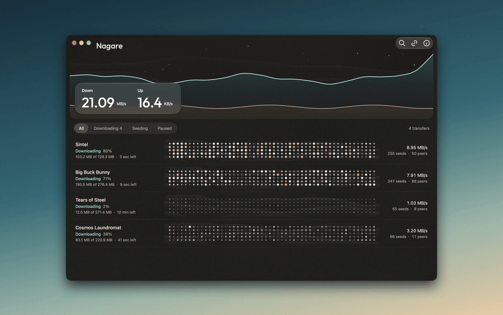
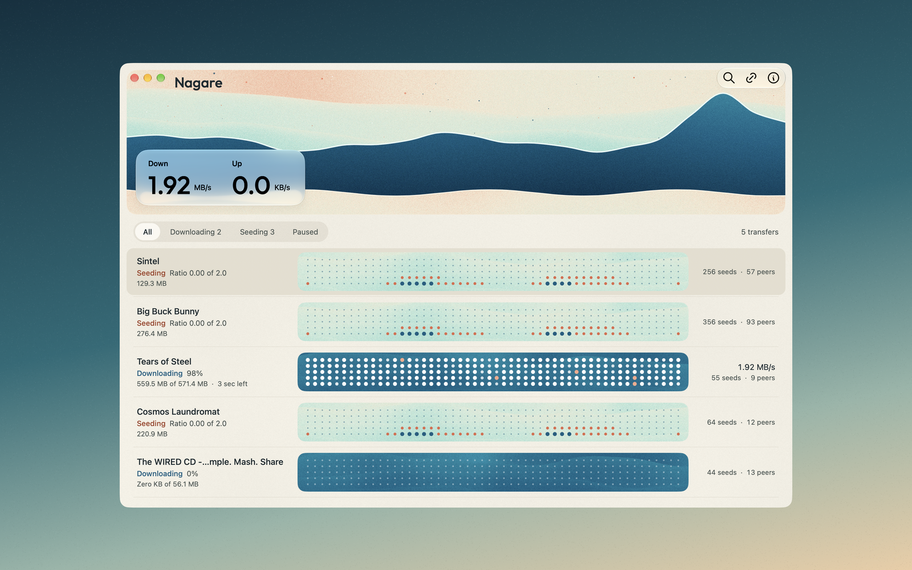
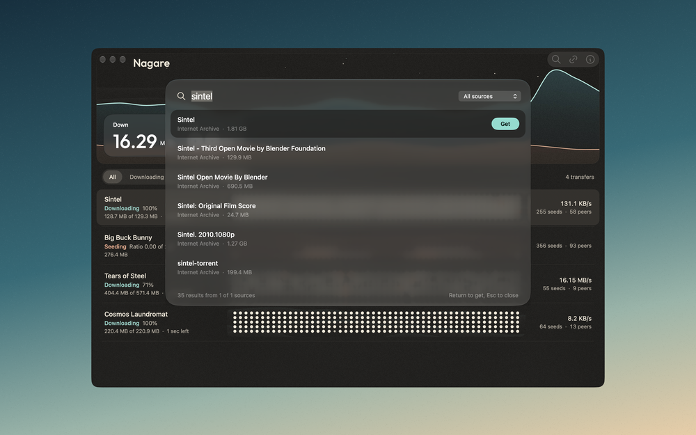
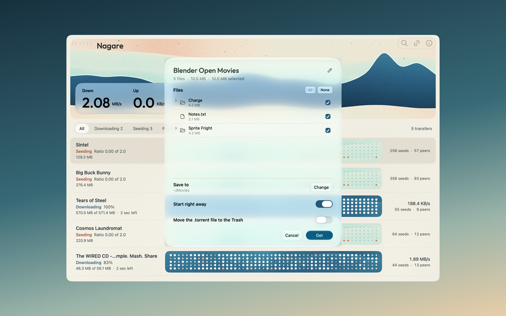
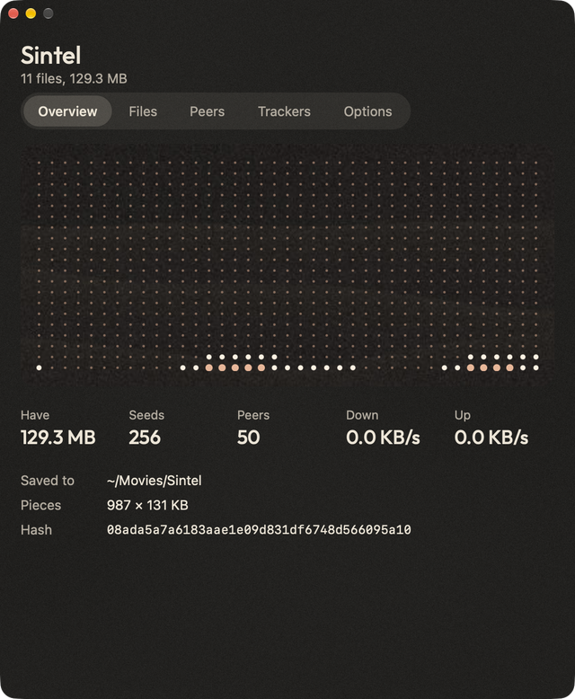
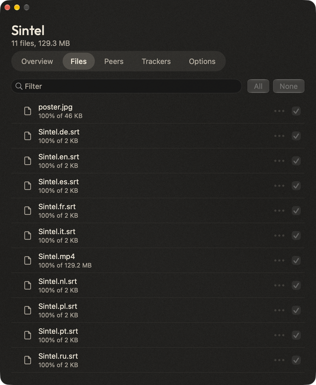
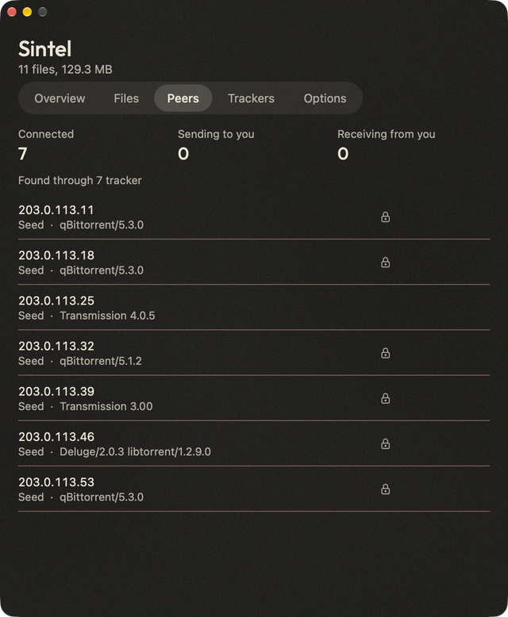

# Nagare

Nagare (流れ, "flow") is a Liquid Glass torrent client for macOS and Windows. It is a redesigned fork of [Transmission](https://transmissionbt.com): the engine is Transmission's `libtransmission` with one small speed fix, and the interface is new.



Short clips are attached to the [latest release](https://github.com/Nik-code/nagare/releases/latest).

- **Swell header:** the water is a graph. The blue swell is the last ten minutes of download speed and the sand in front of it is upload.
- **Droplet rows:** each dot is a share of the file. While seeding, the dots become a tide that rises with your share ratio and moves only during upload. Seeds and peers sit beside the speed.
- **One Add panel:** torrents and magnet links open the same glass panel. Rename the transfer or any file in place before it starts.
- **Search:** sources are JSON files, so they are data and nothing in them is ever run. Internet Archive is built in, and more go in `~/Library/Application Support/Nagare/Search Sources`.
- **qBittorrent import:** on first launch Nagare reads qBittorrent's records, adds its torrents paused and checks the files where they already are. qBittorrent itself is only read, never changed. Run it again from the File menu.
- **Native:** Liquid Glass, Tabler icons, Outfit, with light paper and dark warm grey themes.



<p>
  
  
</p>

<p>
  
  
  
</p>

Nagare has no auto-updater, so it never replaces itself with anything else.

## Install

**Download:** [Mac (Apple Silicon)](https://github.com/Nik-code/nagare/releases/download/v1.1.0/Nagare-1.1.0.dmg) or [Windows (64-bit)](https://github.com/Nik-code/nagare/releases/download/v1.1.0/Nagare-1.1.0-win-x64-setup.exe). Read the notes below first, because neither build is signed by Apple or Microsoft.

### Mac

Needs an Apple Silicon Mac on macOS 26 or later.

With [Homebrew](https://brew.sh):

```bash
brew tap nik-code/nagare
brew trust nik-code/nagare
brew install --cask nagare
```

Or by hand:

1. Download the disk image from the [latest release](https://github.com/Nik-code/nagare/releases/latest) and drag Nagare to Applications.
2. Open it once. macOS will refuse it, as explained below.
3. Go to System Settings, then Privacy & Security, and choose **Open Anyway**. You need this step after a Homebrew install too.

Or clear the download flag from Terminal:

```bash
xattr -dr com.apple.quarantine /Applications/Nagare.app
```

> [!IMPORTANT]
> **Nagare is not notarised.** This is a free hobby project without a paid Apple Developer membership, so releases are signed ad hoc and Apple has not scanned them. macOS will warn you, and you have to choose to open it yourself. If you would rather not trust a prebuilt app, the source is all here and you can [build it yourself](#building).

On first launch Nagare asks macOS to make it the default for magnet links and torrent files. You can say no, and change it later in Settings.

### Windows

Needs 64-bit Windows 10 version 1809 or later. Nothing else: it is one small executable with no runtime to install, and it never asks for administrator rights.

From the [latest release](https://github.com/Nik-code/nagare/releases/latest), take either:

- **`Nagare-<version>-win-x64-setup.exe`**, which installs for your user only and adds a Start menu entry and an uninstaller.
- **`Nagare-<version>-win-x64.zip`**, if you would rather keep `nagare.exe` wherever you like. It still keeps its settings and transfer list in `%LOCALAPPDATA%\Nagare`.

> [!IMPORTANT]
> **Nagare for Windows is not code signed.** This is a free hobby project without a paid signing certificate, so Microsoft has not vouched for it, and SmartScreen will warn you that it comes from an unknown publisher. To run it, choose **More info**, then **Run anyway**. If you would rather not trust a prebuilt app, the source is all here and you can [build it yourself](windows/README.md#building).

The first time it runs, Windows Firewall will ask whether Nagare may use the network. Allowing it lets peers connect to you. Without it downloads still work, only with fewer peers.

Nagare asks once whether it should open your torrent files and magnet links. Windows only lets you make that choice yourself, so saying yes opens Default Apps in Settings at the right place. You can come back to it from Nagare's Settings, which also has Start with Windows and keeping Nagare in the tray when you close the window. All three are off until you turn them on.

Uninstalling removes everything Nagare added to Windows, and asks before deleting your settings and transfer list. It never touches the files you downloaded.

To build it yourself, see [windows/README.md](windows/README.md).

## Building

Needs macOS 26 or later and Xcode 26.

```bash
macosx/build-nagare.sh
```

This builds an arm64 app and installs it to `/Applications/Nagare.app`, signed ad hoc. To make a release disk image instead:

```bash
macosx/package-nagare.sh 1.1.0
```

## Updating from Transmission

The `macosx` and `windows` folders have diverged a lot. `libtransmission` carries one small change to `peer-mgr`, which shows interest in new peers at once and adds an endgame. Upstream engine and security fixes should merge cleanly; Mac interface changes will not.

## How it was made

Designed and built with [Claude](https://claude.com/claude-code), which wrote most of the code under my direction.

## Licence

GPL, like Transmission. See [COPYING](COPYING). Built on Transmission by its authors and contributors, and not affiliated with or endorsed by the Transmission project. Please report Nagare problems here, not to them. Icons are [Tabler](https://tabler.io/icons) (MIT). Outfit is under the SIL Open Font License, included in `macosx/Fonts`.

Use it for things you have the right to share.
